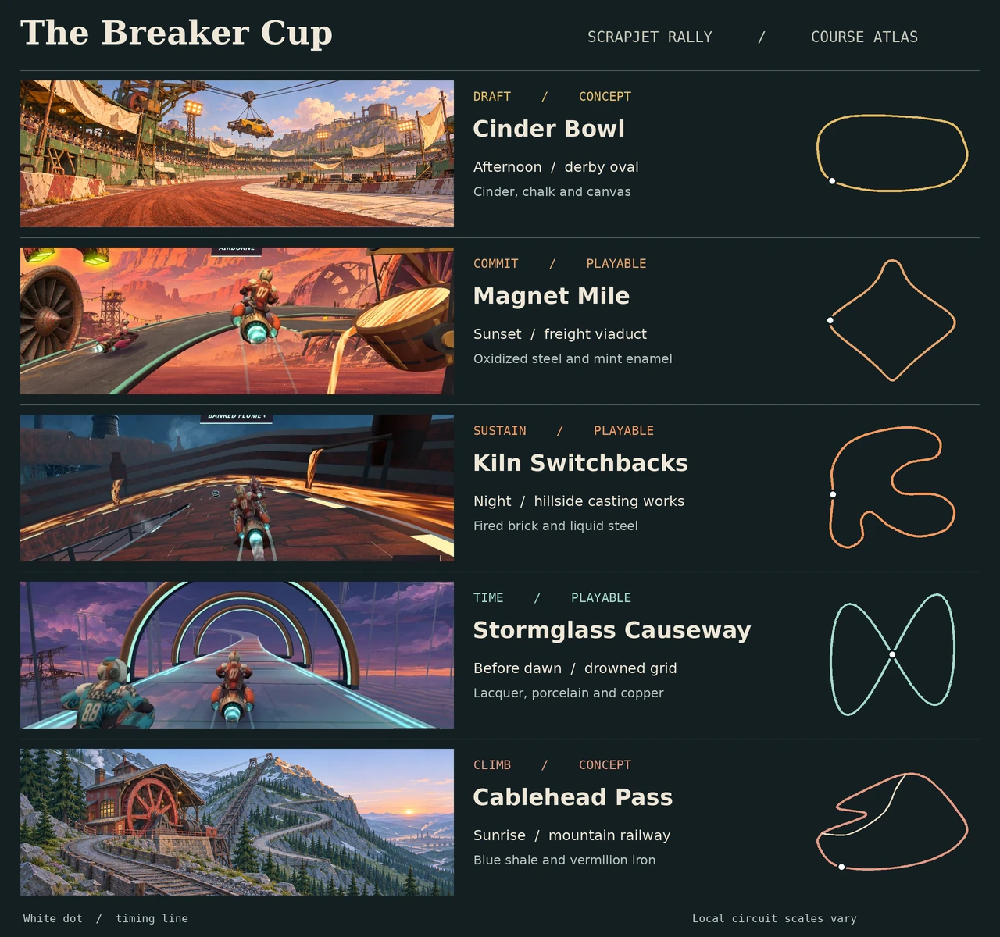

# Scrapjet Rally · The Breaker Cup

Five local races run between the yard siren and the first cable car at dawn. The people in the Bowl grandstand built the other four courses out of places where they work. By the last descent you should recognize their district below you from the shape of the lights.

This preproduction atlas records the original art direction. The middle three environment plates are in-game captures and their maps follow the surveyed racing centrelines. The two bookends are concept paintings and layout sketches. Each map marks the timing line with a white dot. Map scales vary. All five courses are playable. Press ↓ on the grid to enter the Breaker Cup. Each heat is three laps, with 6, 3, 2 and 1 points for the four finishers. A starts the next heat when the rider is ready. Single races have Rookie, Hotshot and Outlaw pack paces relative to FTP and a choice of 3, 12 or 24 laps.

## Cinder Bowl · playable

**The look.** Late afternoon at a demolition derby built in an old gas holder. Iron uprights frame bottle-green bleachers, hand-lettered cream banners and spectators in patched team colours. Pale chalk sweeps across red cinder. A stripped yellow taxi hangs over the infield with its doors missing. Its slow turn catches the last sunlight, then the floodlights pick it up.

**The lap.** A low, asymmetric oval. Start under the announcer's box, take a long round end in sight of the crowd, then slip behind the bleachers onto a quiet back straight. The tighter home turn opens early onto a wide finish. From the back you can still see the taxi above the roof. A dusty outer apron bleeds speed and feeds a wide rider back onto the circuit. Leave enough width for three pods abreast at both apexes.

**The race within the race.** Learn to sit in the wake on the back straight and pull alongside as the stand comes back into view. On the final lap, gaining a place between the last bend and the stripe makes the announcer ring a salvaged tram bell. The payoff is the crowd's reaction. Easy hands and an even stroke work here at every class, including a hard threshold session.

## Magnet Mile · playable

**The look.** A freight yard at orange sunset. Stacks of crushed cars make blocky walls; a torn turbine, lattice cranes and the suspended rail bed break the skyline into teeth. Steel edges catch hard slivers of sun. Mint paint traces the service bridge and amber folded rails frame the launch. The gap shows daylight and the slag below. Give the crane warning bell space in the mix before the rush of air over the gap.

**The lap.** A low, lobed loop with a pinched bend in the first quarter. An early copper-backed pad teaches the markings. At the broken viaduct the road opens like a wishbone. Left curls onto a continuous bridge; right lines up a second pad, the lip and the striped far deck. The branches rejoin in view of each other. Give the landing room to breathe before the later single-span squeeze brings the pack together again.

**The race within the race.** A clean landing already pays a short boost. The crane picks up a missed jump and drops the pod back onto supported deck. The race records a bridge split and a successful jump split between the same gantries. A rider can see what the jump bought on their own legs. Magnet is the place for a short commitment and an optional surge.

## Kiln Switchbacks · playable

**The look.** Night shift inside a hillside casting works. Red refractory brick under the bike, polished copper under the racing seam, black grate bars over moving steel. White-hot metal carries islands of dark crust. Outside the drum the palette opens to smoky blue; warm light from the tapping spouts catches the rider's suit as the pod banks. The pressure hiss builds inside the shell and gives way to the open-air roar of the pour.

**The lap.** A folded hillside loop on two levels. Hold a fixed left seam through the first drum. Its mouth frames the banked descent, with a tiled high edge showing the long left turn before the rider reaches it. The return switchbacks climb back to the second drum, where the copper seam traverses the deck. Each pass through a furnace has a different steering phrase. The route is continuous from grid to finish.

**The race within the race.** At class-relative effort, covering enough of a seam already releases boost at the exit. Charge both drums in one lap and the two furnace whistles answer each other at the stripe. The first drum teaches the steady stroke; the second asks whether you can keep it while trimming across the floor. A tired rider can keep to the middle.

## Stormglass Causeway · playable

**The look.** The drowned electrical district in the violet hour before dawn. Lacquered panels reflect the sky; slim cyan and lilac conductors describe the drop. Split-ring transmission crowns stand in the eyes of the eight. Porcelain insulators stay pale against the clouds. Reserve the local change to amber for a lowering fork. Its silhouette, projected chevrons and warning whine also carry the signal when colour or sound is hard to read.

**The lap.** A tall figure eight with one road crossing about 40 metres above the other. The opening fork works beside the deck. The first live fork reaches in from the right. Drop through four induction ribs, pass below the high road you saw at the start, then read the opposite shoulder on the return. Keep the open middle legible through both encounters.

**The race within the race.** Catch the outside strip while the fork is raised for a pedal-powered charge. A grounded shoe costs momentum. Clear both live strips on one lap and the two distant crowns light in sequence, visible from the next high crossing. This gives a technically ambitious rider something to chase on an easy-power day.

## Cablehead Pass · playable

**The look.** A mountain cable railway at sunrise. Blue shale, dark timber sleepers and spruce give way to bare stone near the saddle. A vermilion flywheel turns inside an open-sided wheelhouse. Its lit rim is visible edge-on from the valley and fills the sky at the crest. Frost stays on the shadow side of the ties. The first sun catches the cable, the wheel and finally the rider.

**The lap.** A long climbing loop with a fork from the valley floor to a common saddle. The carriage road lays two generous switchbacks across the slope; the winch cut takes a tighter entry straight up the cable alignment. The measured branches run **600 m at 2.5%** against **375 m at 4%**. Both gain 15 m. Measure branch distance independently and time the shared split and merge. Beyond the wheelhouse, both lines join a broad downhill horseshoe that looks back across the entire district before returning to the loading yard.

**The race within the race.** The shortcut's prize is elapsed time. Compare each passage with the rider's previous split on that branch. In the seed-3 Hotshot simulation at 78% FTP the carriage road took 44.3 seconds, a clean cut 42.8 and a late cut entry 44.3. At 55% FTP the carriage road was quicker. Trainer grade eases toward demand at one percentage point per second. Power-only riders encounter the climb through speed. Physical trainer validation is pending. On the cup's final descent, the first passenger car of the morning leaves the wheelhouse. That ending belongs to every finisher.

## Continuing art direction

- **Build a skyline the rider learns.** Put the Magnet derrick beyond the Bowl's back straight. Frame Kiln's chimneys between the bridge towers on Magnet. Show the dark transmission crowns from Kiln, then the red wheelhouse above the cloud break on Stormglass. Cablehead pays off those glimpses with the reverse view.
- **Keep the craft and visual language consistent.** Use chunky pod silhouettes, painted wear concentrated at contact points, physical light sources and readable shadows across the cup. Mint edge paint and steady chevrons mark opportunities. Amber motion plus an audible cue marks an active mechanism. Keep the brightest highlights local so riders can read the road on a small display.
- **Give each race its own verb and its own rest.** Draft, commit, sustain, time, climb. Pair them with the quiet back straight, the landing runout, the open flume, the middle of the causeway and the long descent. Keep the rider's class separate from steering complexity. Cinder Bowl opens the cup with space to learn the pack and the chain on a simple road.

[Design discussion #293](https://github.com/BrianBland/wattcade/issues/293) · [Playable PR #294](https://github.com/BrianBland/wattcade/pull/294) · [Cinder Bowl proposal #298](https://github.com/BrianBland/wattcade/issues/298) · [Cablehead Pass proposal #299](https://github.com/BrianBland/wattcade/issues/299)
