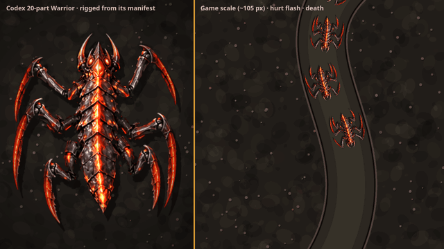

# Hybrid Warrior spike

## v2: Codex's segmented puppet (current)

Full quality: [warrior-segmented.mp4](warrior-segmented.mp4) (7 s, 1280×720).

The art and joint setup are Codex's 20 parts from `../../codex/warrior-parts/`, placed by its `manifest.json`. `dev/td-warrior.html` animates them in code:
- **Legs:** they step in alternating threes (front and rear on one side with the middle on the other). Each leg swings from its socket, the upper leg folds in on the forward swing, and the claw counter-rotates so its tip stays roughly planted.
- **Body:** a yaw wave travels from head to tail across the plates, swinging more toward the tail. It's one wave per stride, so the body snakes as it walks.
- **Mandibles:** they work slowly.
- **Glow:** the seams and eyes pulse as an additive layer.
- **Left side:** the mirrored right-side parts.
- **Hurt flash and death:** as in v1, plus the legs curl and the plates contract as it dies.

## v1: hand cut (superseded)

[warrior-hybrid-v1.gif](warrior-hybrid-v1.gif) · [warrior-hybrid-v1.mp4](warrior-hybrid-v1.mp4)

The Warrior from Codex's roster (`../../codex/td-alien-roster.png`) is cut into 7 parts in `parts/`: the body, plus an upper leg and a scythe claw for each of the 3 right legs. The left legs are the same pieces mirrored. `dev/td-warrior.html` rigs the parts in code:
- **Gait:** an alternating tripod. The claw counter-rotates while the foot is planted so the tip roughly stays put, then lifts and flexes on the forward swing.
- **Body:** sway and bob.
- **Shadow:** drawn from the silhouette.
- **Hurt flash:** a white tint over the composed sprite.
- **Death:** the legs curl, the body darkens and spins, and an acid splat stays behind.

Left: close-up. Right: game scale (about 105 px).

`parts/cut-parts.sh` makes the cut: polygon masks, with alpha from a brightness ramp plus a morphological close. A production version would ask the generator for parts on a transparent background instead.
