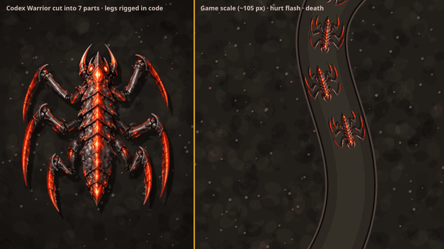

# Hybrid Warrior spike

Full quality: [warrior-hybrid.mp4](warrior-hybrid.mp4) (7 s, 1280×720).

The Warrior from Codex's roster (`../../codex/td-alien-roster.png`) is cut into 7 parts in `parts/`: the body, plus an upper leg and a scythe claw for each of the 3 right legs. The left legs are the same pieces mirrored. `dev/td-warrior.html` rigs the parts in code:
- **Gait:** an alternating tripod. The claw counter-rotates while the foot is planted so the tip roughly stays put, then lifts and flexes on the forward swing.
- **Body:** sway and bob.
- **Shadow:** drawn from the silhouette.
- **Hurt flash:** a white tint over the composed sprite.
- **Death:** the legs curl, the body darkens and spins, and an acid splat stays behind.

Left: close-up. Right: game scale (about 105 px).

`parts/cut-parts.sh` makes the cut: polygon masks, with alpha from a brightness ramp plus a morphological close. A production version would ask the generator for parts on a transparent background instead.
