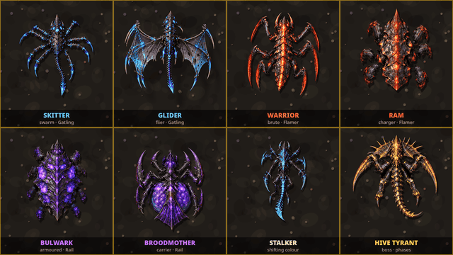
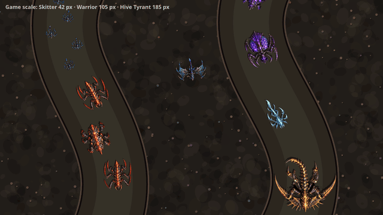
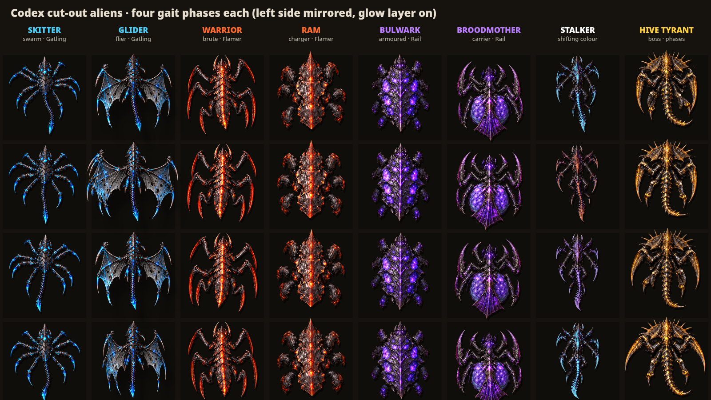

# All eight aliens on the cut-out rig

Codex's puppets (`../../codex/*-parts/`, plus `warrior-parts/`) are loaded from their manifests and animated by one generic rig, `dev/td-roster.html?view=grid|poses|parade`.

## Walking (close-up)

Full quality, 8 s: [aliens-grid.mp4](aliens-grid.mp4)

## Game scale

Full quality, 10 s: [aliens-parade.mp4](aliens-parade.mp4). Sizes: Skitter 42 px, Glider 78, Warrior/Ram 105, Stalker 110, Bulwark 112, Broodmother 120, Hive Tyrant 185.

## Poses (four gait phases each)

## How the rig animates them
- **Legs:** chains are found from the part names (`coxa|socket` → `femur|upper|tube|foot` → `claw|scythe`). Walking legs alternate from front to rear, with the two sides half a step apart: a tripod gait for six legs, a wave gait for the Skitter's eight. Each leg swings from its socket and its claw counter-rotates so the tip stays planted.
- **Body and tail:** body plates carry a yaw wave that travels from head to tail. Tails whip, with the swing growing toward the tip.
- **Per species:**
  - Glider: flaps by foreshortening its wings, with a lifted, blurred shadow and dangling legs.
  - Broodmother: egg sac pulses, rear fan sways.
  - Hive Tyrant: rears up and strikes with its scythes every 2.5 s.
  - Stalker: dorsal tubes sway, and its neutral-white glow is tinted blue → red → purple.
- **Per-species settings:** gait speed, stride, leg and body swing, tail amplitude (see `SPECS` in `dev/td-roster.ts`).
