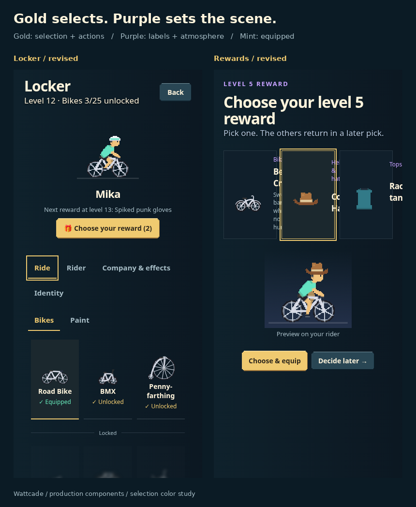

# Selection color study

Gold marks active tabs, selected rewards and primary actions. Purple stays in the rider backdrop and reward/category labels. Mint communicates Equipped.

[Four-page comparison PDF](accent-revision.pdf) · [Locker](locker-comparison.png) · [Phone rewards](reward-comparison.png) · [Desktop rewards](reward-desktop-comparison.png)

The development route uses production Locker/RewardPick components. `accent=previous` recreates the earlier purple-selection proposal; `accent=revised` uses production styling. Both variants keep identical geometry, artwork frames and 44px enabled button targets. This is a palette comparison, not an archived production before screenshot. See [checks](checks.json).

Run Vite on port 5178, then `node scripts/capture-accent-revision.mjs` and `python scripts/package-accent-revision.py` (Pillow). Override the capture server with `CHROME_REVIEW_URL`. Open `/dev/accent-revision.html?view=locker&accent=revised` or `view=reward`.
