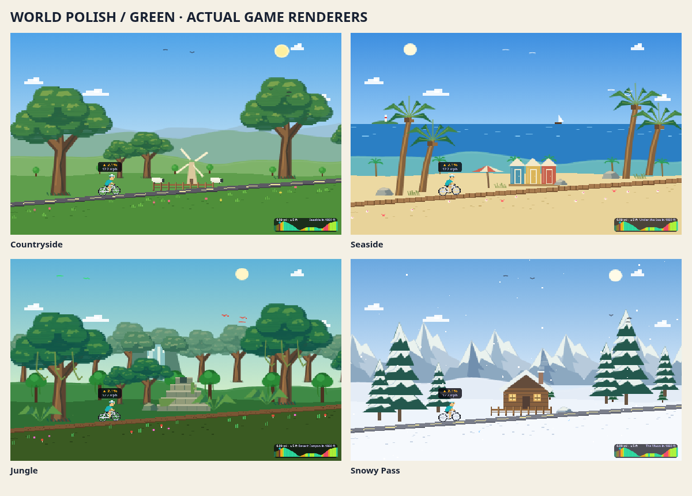
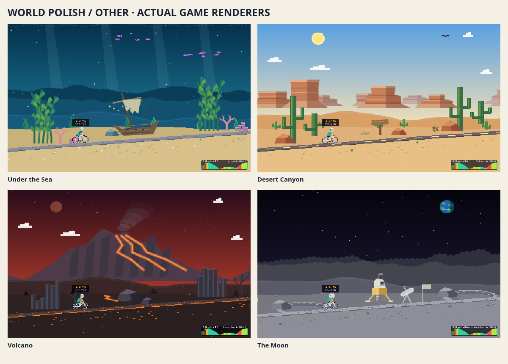
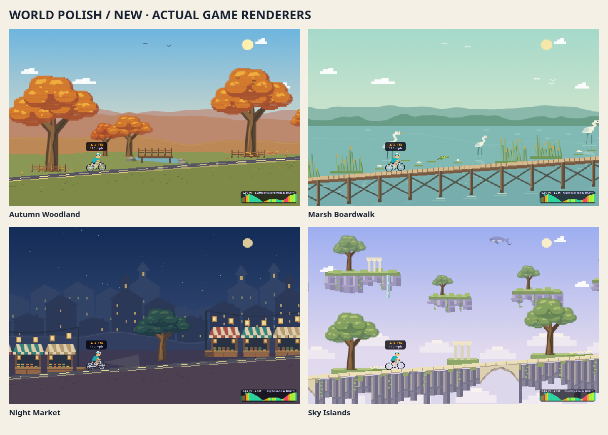
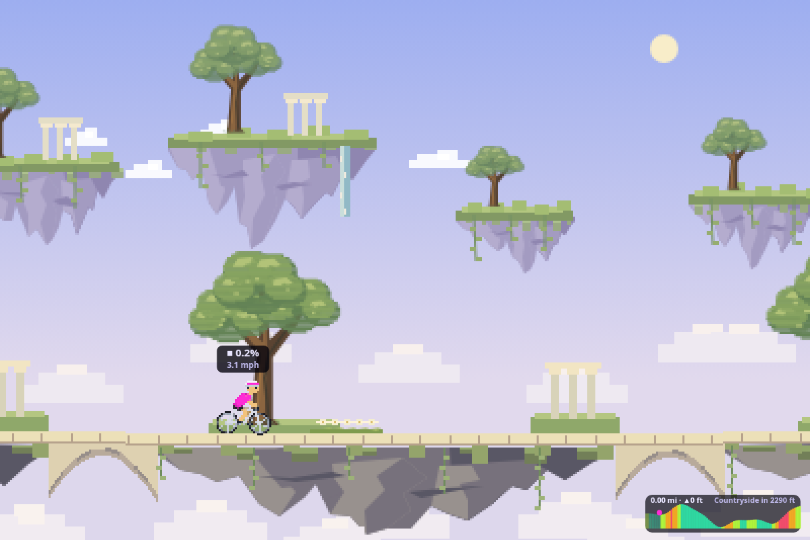
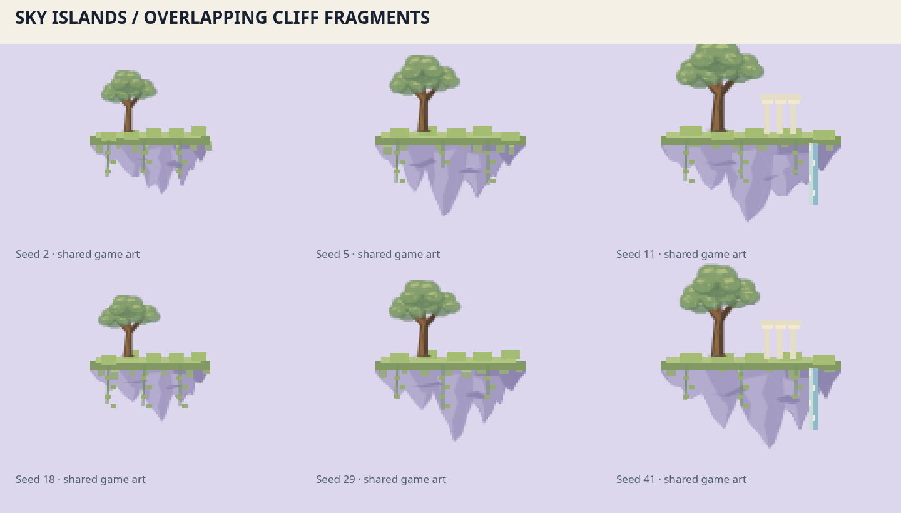

# Overworld biome polish

Four appended biomes: autumn woodland, marsh boardwalk, lantern market and sky islands. Original IDs and achievement bits remain stable. All eight existing biomes gain larger trees, road-anchored scenery and landmarks. Existing owners retain Globetrotter; new progress uses all twelve destinations.

The new-biome overview predates the final sky refinement. These are the final cliff shapes: overlapping jagged fragments, unequal ledges and tips, a loose triangular mass, draping turf and cloud occlusion.

Marsh cranes dip their necks; frogs hop and leave ripples. Sky whales and birds cross the scene; waterfalls and foliage animate. Quiet procedural voices follow the soundscape scheduler, stop while parked and duck with media.

## Reproduce
Start `npm run dev -- --host 127.0.0.1 --port 5199 --strictPort`. With Chromium at `/usr/bin/chromium` and ffmpeg installed:

- `node scripts/capture-world-polish.mjs` — native biome and transition stills.
- `node scripts/capture-world-motion.mjs` — motion clips for all twelve biomes.
- `node scripts/capture-sky-review.mjs` — final still, six seeds, eight-second gameplay clip and caller-state check.
- `node scripts/capture-biome-sounds.mjs` — standalone accelerated sound audition.

Outputs default to `/tmp/wattcade-biomes`; pass an output directory as the first argument. Test with `npm test -- src/games/warmup src/progression/achievements.test.ts`, typecheck and build. Actual iPad/WebKit frame pacing and audio levels still need a device pass.
