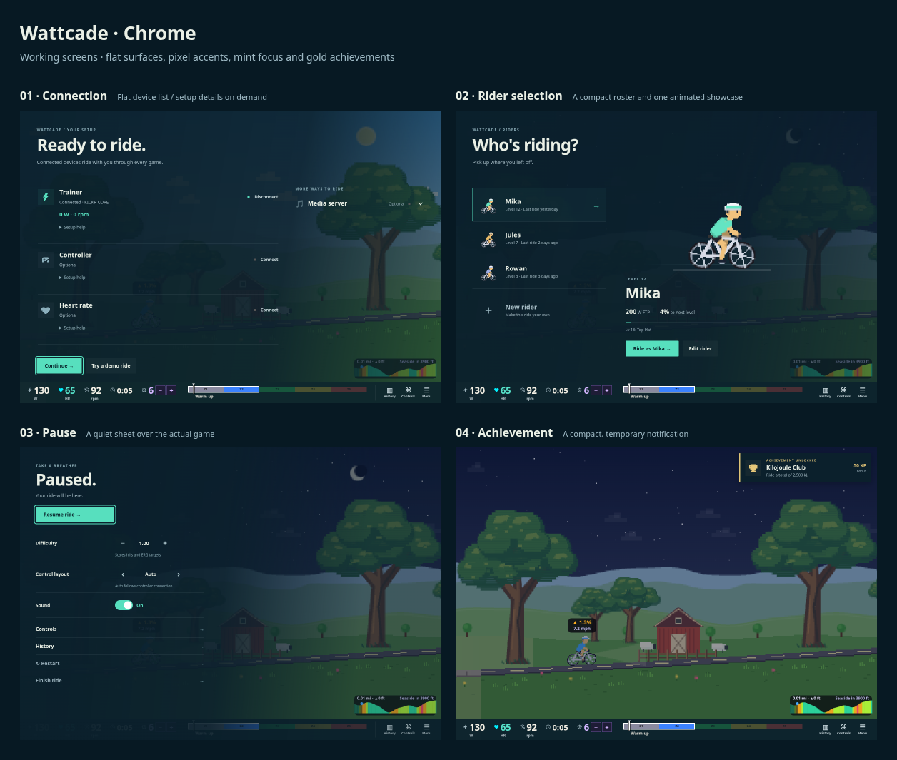

# Flat game chrome review

These are working production components over the actual game renderer. Rider/device data is a development fixture; no real device is connected in these captures.

[Phone review at full resolution](phone-review.png)

| Screen | Desktop 1180×820 | Phone 390×844 | Landscape 844×390 |
| --- | --- | --- | --- |
| Connection | [Capture](desktop-connect.png) | [Capture](phone-connect.png) | [Capture](landscape-connect.png) |
| Rider selection | [Capture](desktop-riders.png) | [Capture](phone-riders.png) | [Capture](landscape-riders.png) |
| Pause | [Capture](desktop-pause.png) | [Capture](phone-pause.png) | [Capture](landscape-pause.png) |
| Achievement | [Capture](desktop-achievement.png) | [Capture](phone-achievement.png) | [Capture](landscape-achievement.png) |

- Connection: flat device rows with pixel icons, live readings and explicit connect/disconnect. Setup instructions expand on demand; saved watches, retry/cancel, controller pairing and the optional media form remain available. Media setup starts collapsed, including for saved configurations; its summary shows Optional/Enabled/Connected. Tap, keyboard or controller A expands it. The device list scrolls while Continue remains reachable. No duplicate Add watch action when Connect already opens the picker and no saved watches exist.
- Rider selection: compact roster and one animated selected-rider showcase. Touch previews a rider, then starts with Ride; phone rosters scroll with gestures. Controller up/down or left/right chooses, A rides and Y edits.
- Pause: a left sheet with vertical navigation, flat settings and clear Resume. Retains help/history/restart/finish, fake-bike instructions when applicable and game-specific actions. Long menus scroll.
- Achievements: a temporary upper-right banner with a pixel trophy, unlocked goal and bonus XP; clears after six seconds. The earning and saving rules are unchanged.
- Physical controller labels only appear with an attached controller. All real buttons retain at least 44px height; instrument readings retain the existing compact HUD. Mobile sheets use a stronger backdrop for legibility.

## Reproduce

Run `npm run dev -- --host 127.0.0.1`. Open `/dev/chrome-review.html?game=warmup&manual=1&fake=0&legend=0&view=connect`, replacing `connect` with `riders`, `pause` or `achievement`. Connection also accepts `state=busy` and `state=error`. `review.html` assembles the captured screenshots; `?phone` selects the phone board.

Validation: the shell suite passes, with targeted saved-settings and controller-toggle checks after the media-collapse change. Typecheck and production build pass. `CHROME_REVIEW_URL=http://127.0.0.1:5173 node scripts/check-chrome.mjs` checks all four screens at 320×568, 390×844, 844×390 and 1180×820: no horizontal overflow or undersized buttons, reachable continuation/pause actions, rider preview/start, and media setup collapsed by default with working touch/keyboard expansion. Unit tests cover physical-label attach/detach, preview versus starting, controller selection, notification queue and expiry, and existing Bluetooth retry/cancel behavior.

Browser captures use Chromium with zero safe-area insets. Bluetooth and native iOS behavior still need device validation.
