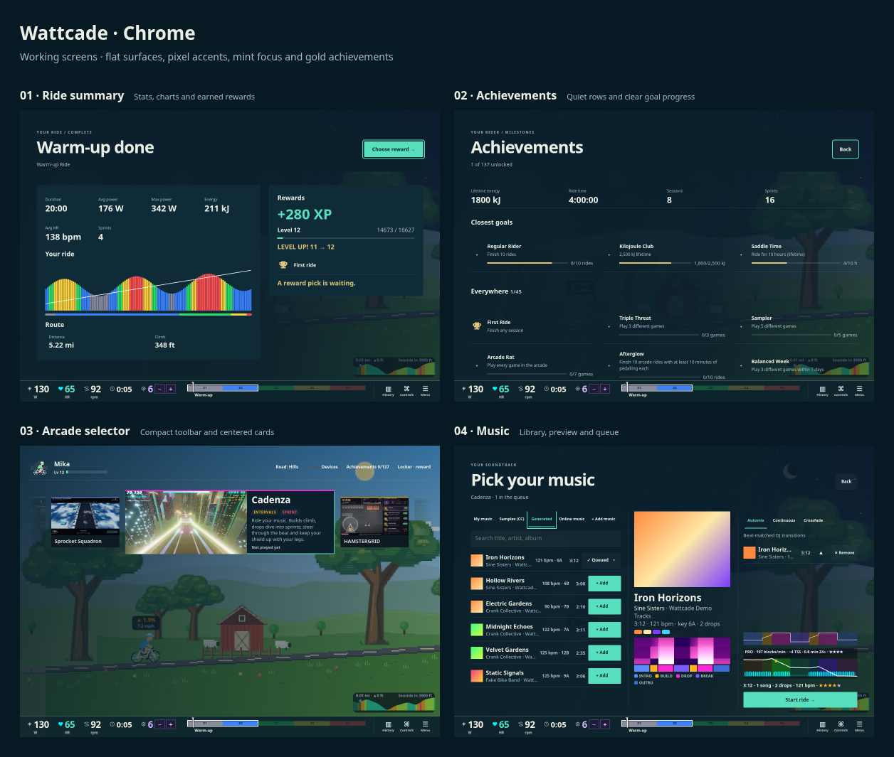

# Shared UI and shell chrome review

These are working production components over the actual game renderer. Rider/device data is a development fixture; no real device is connected in these captures.

Canonical design rules and integration examples: [UI style guide](../../UI_STYLE_GUIDE.md). The interactive DOM/Canvas component gallery is `/dev/ui-kit.html` when Vite is running.

[Original setup/rider/pause review](desktop-review.png) · [DOM/Canvas gallery capture](desktop-ui-kit.png) · [Phone gallery](phone-ui-kit.png)

[Phone review at full resolution](phone-review.png)

| Screen | Desktop 1180×820 | Phone 390×844 | Landscape 844×390 |
| --- | --- | --- | --- |
| Connection | [Capture](desktop-connect.png) | [Capture](phone-connect.png) | [Capture](landscape-connect.png) |
| Rider selection | [Capture](desktop-riders.png) | [Capture](phone-riders.png) | [Capture](landscape-riders.png) |
| New rider | [Capture](desktop-new-rider.png) | [Capture](phone-new-rider.png) | [Capture](landscape-new-rider.png) |
| Edit rider | [Capture](desktop-edit-rider.png) | [Capture](phone-edit-rider.png) | [Capture](landscape-edit-rider.png) |
| Pause | [Capture](desktop-pause.png) | [Capture](phone-pause.png) | [Capture](landscape-pause.png) |
| Result banner | [Capture](desktop-result.png) | [Capture](phone-result.png) | Verified in browser matrix |
| Ride summary | [Capture](desktop-summary.png) | [Capture](phone-summary.png) | Verified in browser matrix |
| Achievements page | [Capture](desktop-achievements.png) | [Capture](phone-achievements.png) | Verified in browser matrix |
| Arcade selector | [Capture](desktop-arcade.png) | [Capture](phone-arcade.png) | [Capture](landscape-arcade.png) |
| Music browser | [Capture](desktop-media.png) | [Capture](phone-media.png) | Verified in browser matrix |
| Controls guide | [Capture](desktop-controls.png) | [Capture](phone-controls.png) | Verified in browser matrix |
| Loading | [Capture](desktop-loading.png) | [Capture](phone-loading.png) | Verified in browser matrix |
| Error | [Capture](desktop-error.png) | [Capture](phone-error.png) | Verified in browser matrix |
| Achievement | [Capture](desktop-achievement.png) | [Capture](phone-achievement.png) | [Capture](landscape-achievement.png) |

- Connection: flat device rows with pixel icons, live readings and explicit connect/disconnect. Setup instructions expand on demand; saved watches, retry/cancel, controller pairing and the optional media form remain available. Media setup starts collapsed, including for saved configurations; its summary shows Optional/Enabled/Connected. Tap, keyboard or controller A expands it. The device list scrolls while Continue remains reachable. No duplicate Add watch action when Connect already opens the picker and no saved watches exist.
- Rider selection: compact roster and one animated selected-rider showcase. Touch previews a rider, then starts with Ride; phone rosters scroll with gestures. Controller up/down or left/right chooses, A rides and Y edits.
- New/edit rider: flat scrolling settings rows, a live rider preview and reachable Save/Cancel. Touch color choices have 44px targets; delete and backup actions remain available. Aim is removed from both forms without altering saved aim behavior.
- Pause: a left sheet with vertical navigation, flat settings and clear Resume. Retains help/history/restart/finish, fake-bike instructions when applicable and game-specific actions. Long menus scroll.
- Achievements: a temporary upper-right banner with a pixel trophy, unlocked goal and bonus XP; clears after six seconds. The earning and saving rules are unchanged.
- Remaining chrome: result/summary/achievement pages, selector toolbar/carousel, music library/queue/preview, controls help and loading/error states share canonical DOM widgets and token values. Phone music uses Browse/Queue/Preview tabs; [queue](phone-media-queue.png) and [preview](phone-media-preview.png) captures show the other panels. Summary supports controller scrolling; results and summary use the rider's units. Carousel cards start at their measured size, share a centerline and sit immediately below the toolbar in a strip sized to their content, leaving the overworld below; short landscape uses a side-by-side card; toolbar help escapes overflow clipping.
- Physical controller labels only appear with an attached controller. All real buttons retain at least 44px height; instrument readings retain the existing compact HUD. Mobile sheets use a stronger backdrop for legibility.

## Reproduce

Run `npm run dev -- --host 127.0.0.1`. Open `/dev/chrome-review.html?game=warmup&manual=1&fake=0&legend=0&view=connect`, replacing `connect` with `riders`, `new-rider`, `edit-rider`, `pause`, `achievement`, `result`, `summary`, `achievements`, `arcade`, `media`, `controls`, `loading` or `error`. Connection also accepts `state=busy` and `state=error`. `review.html` assembles the captured screenshots; `?phone` selects the phone board; `?finish` selects the remaining-chrome board (combine both flags for phone).

Validation: 221 UI/shell tests, typecheck and production build pass. `CHROME_REVIEW_URL=http://127.0.0.1:5173 node scripts/check-chrome.mjs` covers 56 screen/viewport cases at 320×568, 390×844, 844×390 and 1180×820. It checks horizontal overflow, 44px buttons, controller-less hints, reachable actions, native activation once, profile saving, media setup disclosure, card alignment, portaled tooltips, queue add/remove/undo, mode tabs and simulated mobile-keyboard search/dismissal. The arcade cases were rerun after removing the initial unmeasured-card transition. A standalone gallery check at 320px and 1180px verifies keyboard tabs, focus/tooltip behavior, reduced motion and touch targets. Unit tests also cover token/CSS drift, Canvas progress/insets/disabled hits, UI states, controller scrolling, profile/achievement persistence behavior and notification cleanup.

Game-owned menus and their legacy drawing helpers remain for the follow-up migration using the new guide.

Browser captures use Chromium with zero safe-area insets. Bluetooth and native iOS behavior still need device validation.
