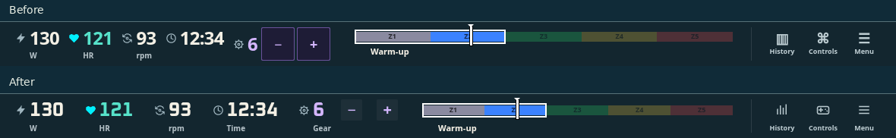
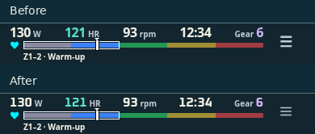
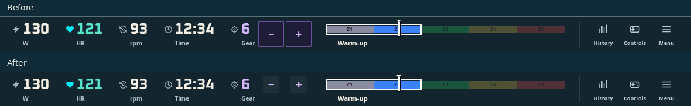

# HUD alignment and numeric typography

Rebased on `main` at f793116 (including #174 and native KICKR shifting).

The old instrument cells differed in height: time had no caption and gear centered
its value beside its touch controls. At 768px, their numeric tops varied by 7.5px;
desktop touch gear sat 8px below the other readings. The new layout uses a 28px
main row, 4px gap and 12px caption for every desktop instrument and utility. The
zone rail and SVG utility icons center on that same main row. Time and Gear gain
captions; compact time keeps its self-describing format without an extra label.

All five readings use the self-hosted Oxanium 700 numeric subset (2,512 bytes,
SIL OFL 1.1). Labels retain system type. Sizes are uniform within each viewport:
26px desktop, 20px narrower tablet, 16px compact, 14px at <=360px. The small-phone
spacing also handles four-digit watts, three-digit cadence, hour-long time and
24 gears without wrapping. Gear symbols sit in 28px quiet faces centered on the numeric row, with transparent 44px touch targets around them; compact gear adjustment
stays inside the tools popup. Controller behavior and native shifting are retained.





| View / input | Instrument bar before | After | Numeric top spread after |
| --- | ---: | ---: | ---: |
| 1180×820 mouse | — | 59px | 0px |
| 1180×820 controller | 59px | 59px | 0px |
| 1180×820 touch | 59px | 59px | 0px |
| 390×844 touch | 51px | 51px | 0px |
| 320×568 touch | 51px | 51px | 0px |
| 844×390 touch | 51px | 51px | 0px |
| 768×1024 controller | 59px | 59px | 0px |
| 768×1024 touch | — | 59px | 0px |
| 701×900 touch | — | 59px | 0px |
| 1051×820 touch | — | 59px | 0px |

These measure the instrument bar; existing floating actions/controller navigation
still contribute their independently measured insets. No safe-area inset is
emulated. Full viewport screenshots and tight bar crops are included for every
after case; the first six have matched before captures. JSON records geometry,
computed fonts, insets and long-value checks. Baseline is the rebased UI before
this HUD change, rather than the earlier stacked mobile version.

Reproduce with Vite running (HMR disabled while writing screenshots):

```sh
REVIEW_URL=http://127.0.0.1:5220 node scripts/check-hud-alignment.mjs /tmp/hud-alignment
REVIEW_URL=http://127.0.0.1:5220 node scripts/check-compact-hud.mjs /tmp/hud-matrix
npm run typecheck
npx vitest run src/shell src/ui
npm run build
```

The alignment script checks ten viewport/input permutations, normal and long values,
font selection, equal baselines/sizes, cell separation, viewport boundaries,
desktop zone/tool centerlines and unchanged bar heights. Actual production HUD
components render over the real Warm-up renderer with deterministic dev data;
the long-value check replaces only displayed text to exercise font widths.
Physical iOS/controller validation remains a device check.

Validation completed: 223 UI/shell tests, typecheck and production build pass;
all 48 game/viewport/input browser cases pass with no page errors; all ten
alignment/input/breakpoint cases pass with normal and long values. The build retains
its existing large Three.js chunk advisory.


Gear-button follow-up: the previous full-height boxes centered +/- across the
number and caption, 8px below the numeric/zone centerline. The visible faces and
44px hit regions now share the numeric centerline. Compact tools-panel buttons
retain their existing layout. The browser regression checks both centerlines
with normal/long values, fine mouse input and coarse touch input. Typecheck and
all 52 HUD tests pass after this correction.


