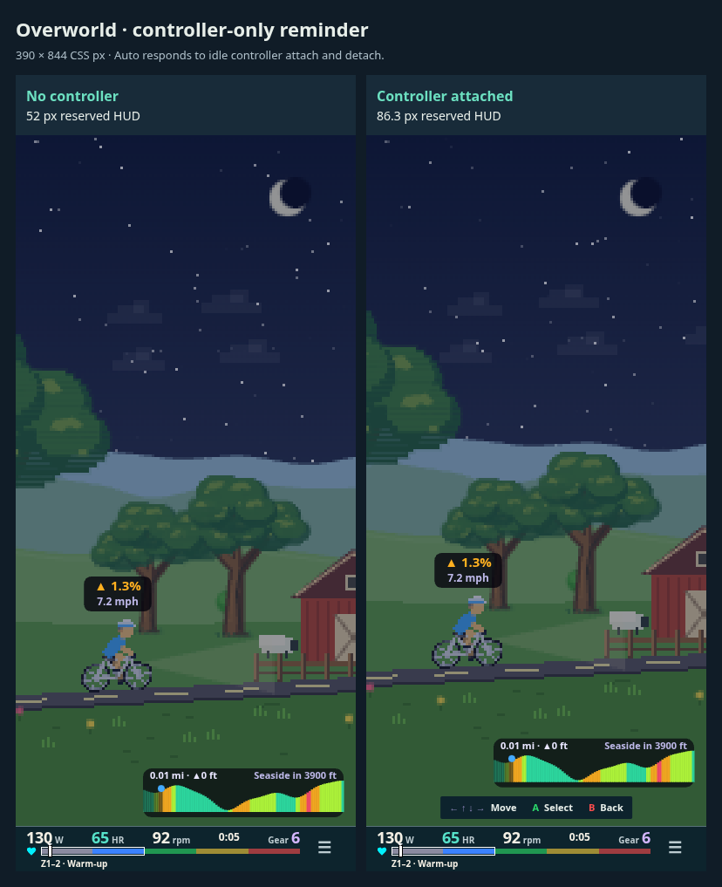
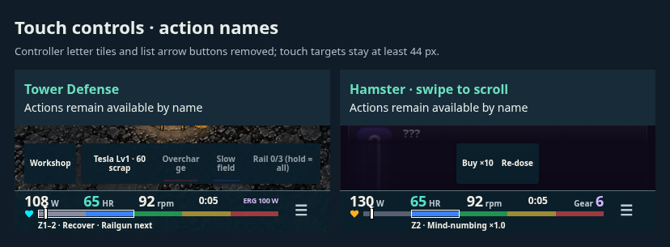

# Gesture lists and controller-only overworld guide

The Hamster shop scrolls with swipe/drag, wheel and trackpad input. Rows activate on release; moving more than 8 CSS pixels, pointer cancellation, blur, resize or an overlay over the release cancels the tap. Scroll is clamped to the list and persists without selecting or purchasing rows. A native row tap keeps its position; controller row navigation resumes automatic centering. Hit regions are clipped to the visible list. The redundant up/down touch buttons are removed; native tabs, row purchases and trial acceptance remain.

Live touch controls show action names instead of A/B/Y/Z letter tiles. Direction/gear symbols that carry meaning remain. The inert paddle legend is removed from live touch controls; the complete controller guide retains physical references.

The overworld opts into `GameHud.persistentLegend` because it has no pregame guide. Visible menus (including the game selector) own their contextual A/B/arrows/gears hints; the HUD reminder is suppressed while those menus are on screen. Once menus fade away, with an attached controller in Auto the HUD shows a small read-only Move / A Select / B Back reminder; disconnecting removes it. Controller presence is checked live, without requiring a button press. Explicit Touch/Controller overrides remain available. The guide is measured as a floating occlusion and never steals pointer input.

At 390 × 844 CSS px, the captured overworld reserves 52 px without a controller and 86.3 px with its persistent controller guide. The guide adds 26.3 px and an 8 px gap. Real game session captures use coarse-pointer Chromium emulation, device scale factor 1, zero safe-area inset and 5 simulation seconds of fake Z2 input. Shop gesture captures use an unlocked preset to expose overflow.

[Shop before swipe](./screens/shop-before.png) · [Shop after swipe](./screens/shop-after.png)

Validation: 48 browser layout cases across all eight games and both input modes pass, including labels, long quotes, touch target bounds and conservative insets. The dedicated native gesture check uses real browser touch events to prove swipe/wheel scrolling, no purchase on drag or cancellation, a successful tap purchase, controller centering after manual scrolling, and live controller attach/detach. The 229-test shell/Hamster suite passed; the added inert-paddle regression passed in the final Pad suite. Typecheck and production build pass. Physical iPad/Bluefy validation remains.

Reproduce: `node scripts/check-hud-gestures.mjs /tmp/hud-gestures` against the local Vite server (`REVIEW_URL` can override port 5212). The all-game matrix is `scripts/check-compact-hud.mjs`. `dev/hud-live.html?game=hamster&shop=1&legend=0` supplies the unlocked shop review fixture.
