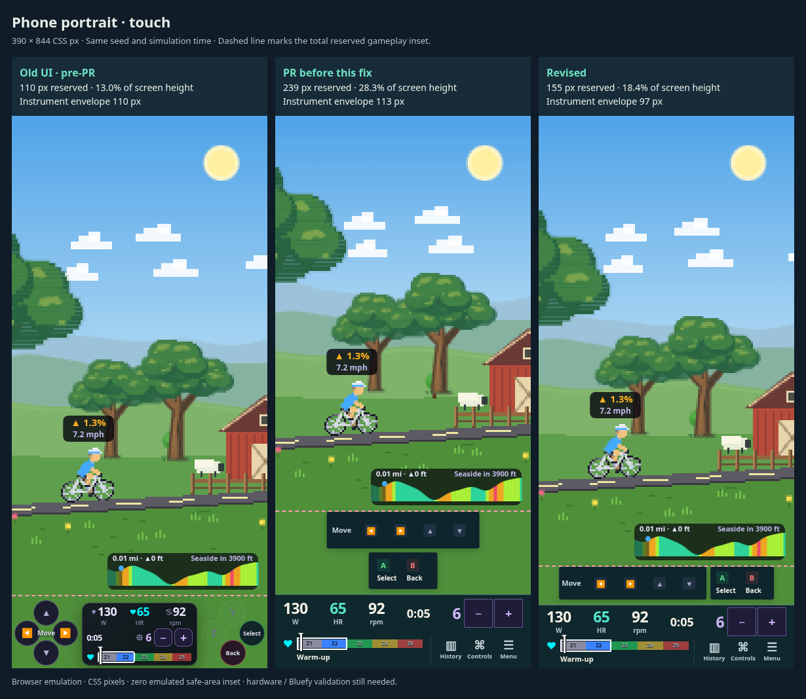
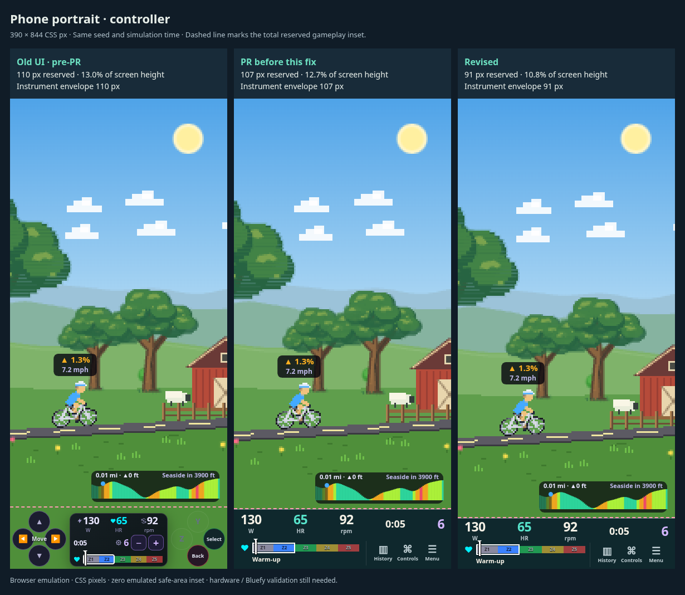
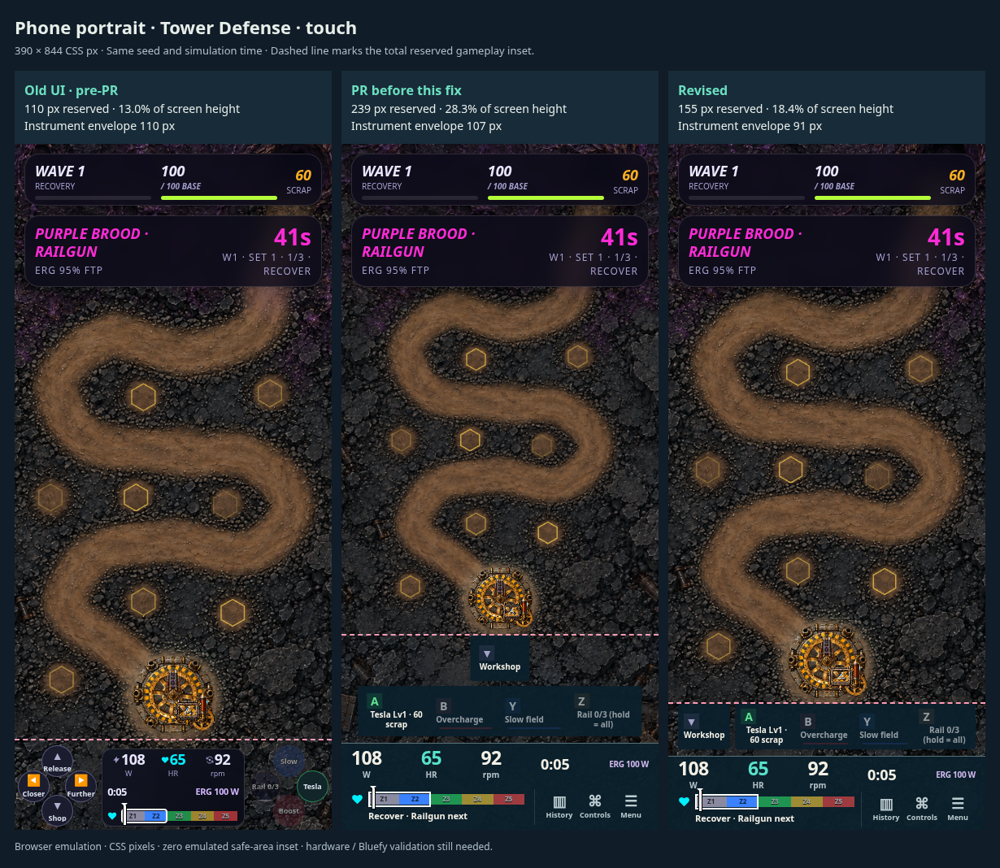
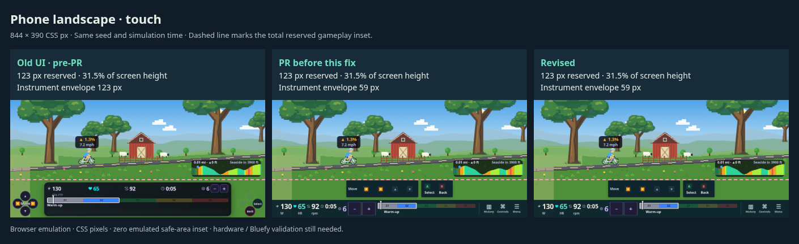
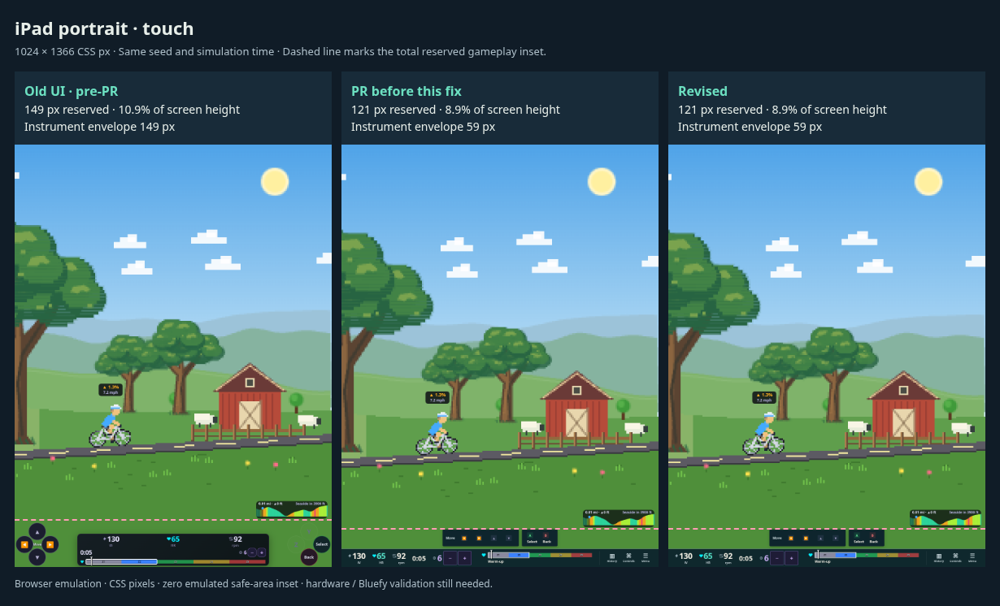
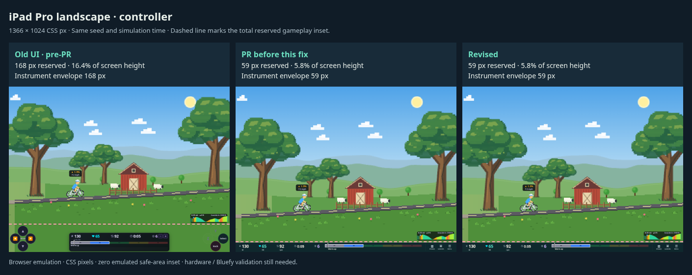
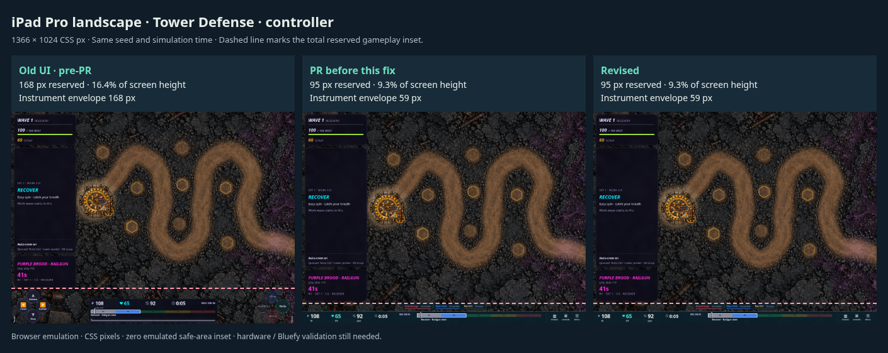

# Responsive HUD: measured comparison

The portrait touch regression came from forcing Move and face controls onto separate rows below 700 px, together with a 100 px minimum instrument area and generous row spacing. The fix keeps the two touch groups alongside one another and reduces padding and row spacing. Busy groups can wrap individual keys when the screen cannot fit every 44 px target on one row. Touch hit targets stay at least 44 × 44 px. Very narrow screens omit the repeated movement caption; action names remain on the buttons.

“Old UI” is the default legend-on UI at `a6e01c1`, immediately before this PR. It showed the full controller legend even without an attached controller. “PR before this fix” is `0dc5433`. “Revised” includes this responsive fix. These are real renderers and HUD components, not design mockups.

Measure **total reserved height**, including the floating controls and the gap above the bottom bar. This is the conservative `readHudInsets().bottom` used to position foreground game content. The bottom bar alone understates the footprint. Dashed screenshot lines mark this boundary; narrow floating controls do not actually paint the entire area below the line.

| Device / input / game | Viewport | Old px | PR before fix px | Revised px (% height) | Revised − old px |
| --- | --- | ---: | ---: | ---: | ---: |
| [Phone portrait · touch](./phone-touch-comparison.png) | 390 × 844 | 110 | 239 | **155** (18.4%) | +45 |
| [Phone portrait · controller](./phone-controller-comparison.png) | 390 × 844 | 110 | 107 | **91** (10.8%) | -19 |
| [Phone portrait · Tower Defense · touch](./phone-td-touch-comparison.png) | 390 × 844 | 110 | 239 | **155** (18.4%) | +45 |
| [Phone landscape · touch](./phone-landscape-touch-comparison.png) | 844 × 390 | 123 | 123 | **123** (31.5%) | +0 |
| [iPad portrait · touch](./ipad-portrait-touch-comparison.png) | 1024 × 1366 | 149 | 121 | **121** (8.9%) | -28 |
| [iPad Pro landscape · controller](./ipad-landscape-controller-comparison.png) | 1366 × 1024 | 168 | 59 | **59** (5.8%) | -109 |
| [iPad Pro landscape · Tower Defense · controller](./ipad-td-controller-comparison.png) | 1366 × 1024 | 168 | 95 | **95** (9.3%) | -73 |

Warmup and Tower Defense portrait touch recover 84 px from the previous PR version (35% less HUD height). It still reserves 45 px more than the old UI. Old warmup phone controls included 28 px targets and Tower Defense 39 px targets; the revised UI preserves 44 px targets and readable action copy. This remains a tradeoff, not a claim that the new touch layout is smaller than the original.

The revised warmup portrait bar is 97 px, plus 50 px of controls and an 8 px gap. Tower Defense is 91 + 56 + 8 = 155 px. With a controller, warmup has no floating action row; Tower Defense adds its actual cooldown/special status strip.

All captures use coarse-pointer Chromium emulation, device scale factor 1, seed 3, fake Z2 input at 5 simulation seconds, history closed and fake-bike help hidden. Both controller and touch variants use the same session fixtures. Controller mode is explicitly selected; the connection switch is verified separately by the native matrix. CSS safe-area insets are zero in these captures; browser chrome and a real iPad home indicator are excluded. Rounded values in the table can differ by less than one pixel from the JSON geometry. Raw measurements and full-resolution captures are in the three version directories.

A busy eight-button touch layout still requires wrapped keys: [Hamster portrait screenshot](./hamster-phone.png) reserves **200 px** (23.7% of the phone), with every target at least 44 px. The 155 px result is not a universal ceiling across games or long action quotes.

Validation: 48 browser layout cases (eight games × three viewports × both input modes), extra 320/360 px touch checks, idle controller connect/disconnect, optional history, long quotes and controls help pass. Typecheck, production build and all 195 shell tests pass. The native browser script now enforces a 160 px portrait budget for the standard warmup and Tower Defense fixtures.

## Reproduce

Run the current dev server and use `node scripts/review-responsive-hud.mjs revised http://127.0.0.1:5212 /tmp/hud-responsive/revised`.

For the old version, create a detached worktree at `a6e01c1`, link installed dependencies, copy `dev/hud-live.html` and `dev/hud-live.tsx` from this branch, replace the harness's layout type import with the local `'auto' | 'touch' | 'controller'` type and `layout={layout}` with `legendOn={layout !== 'touch'}`, then run that server separately. Use the same review script with version `old`; it selects the old default legend-on behavior for every device. The copied harness calls the old `readHudInsets` and old HUD, not the new measurement code.

## Captures

### Phone portrait · touch

### Phone portrait · controller

### Phone portrait · Tower Defense · touch

### Phone landscape · touch

### iPad portrait · touch

### iPad Pro landscape · controller

### iPad Pro landscape · Tower Defense · controller

