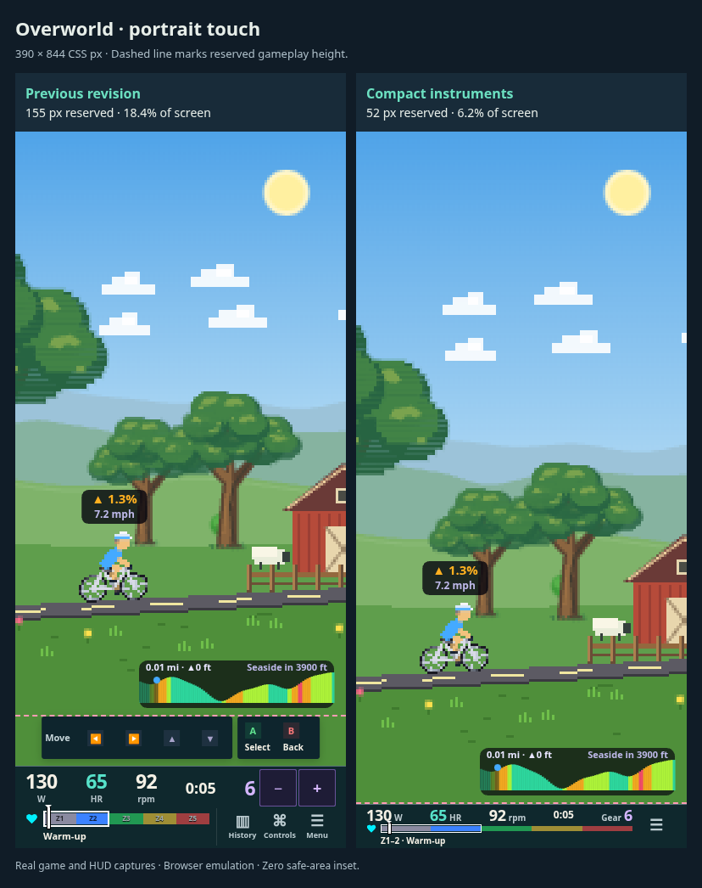
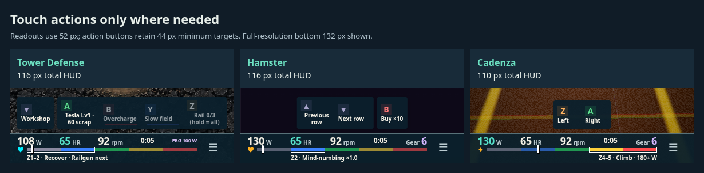

# Compact read-only instruments and native touch controls

The last portrait version still coupled read-only instruments to touch button sizes. This version uses inline watts, HR, cadence, time and gear/trainer readings, a 6 px zone rail, explicit target range and target label, and one 44 px tools toggle on phones and short landscape viewports. History, complete controls help, Pause/menu and touch gear adjustment live in the tools panel. Its opening does not reserve gameplay height. Closing it unmounts gear controls and cancels holds. Larger screens retain their existing instrument arrangement.

The shell now treats an explicit empty touch-control list as no action strip, with no floating gap. Overworld navigation is supplied by the native arcade menus. Cadenza has one touch action per lane, with duplicate arrows retained in controller help. Hamster already supports native tab, row purchase and trial taps; touch retains up/down list navigation, Buy ×10 in generators, and Re-dose after it unlocks. Controller bindings remain available in the full guide. No new gesture is assumed to exist; games still keep touch actions that have no native equivalent.

Heights include the conservative bottom gameplay inset: instrument bar, floating actions and gap. Baseline is the previous responsive revision `934b2d2`; raw geometry comes from the real components and renderers at the same seed and simulation time.

| Configuration | Viewport | Previous total px | New bar px | New total px (% height) |
| --- | --- | ---: | ---: | ---: |
| [Overworld · portrait touch](./screens/phone-touch.png) | 390 × 844 | 155 | 52 | **52** (6.2%) |
| [Overworld · portrait controller](./screens/phone-controller.png) | 390 × 844 | 91 | 52 | **52** (6.2%) |
| [Tower Defense · portrait touch](./screens/phone-td-touch.png) | 390 × 844 | 155 | 52 | **116** (13.7%) |
| [Overworld · landscape touch](./screens/phone-landscape-touch.png) | 844 × 390 | 123 | 51 | **51** (13.1%) |
| [Overworld · iPad portrait touch](./screens/ipad-portrait-touch.png) | 1024 × 1366 | 121 | 59 | **59** (4.3%) |
| [Overworld · iPad landscape controller](./screens/ipad-landscape-controller.png) | 1366 × 1024 | 59 | 59 | **59** (5.8%) |
| [Tower Defense · iPad landscape controller](./screens/ipad-td-controller.png) | 1366 × 1024 | 95 | 59 | **95** (9.3%) |
| [Hamster · portrait touch](./screens/phone-hamster-touch.png) | 390 × 844 | 200 | 52 | **116** (13.7%) |
| [Cadenza · portrait touch](./screens/phone-cadenza-touch.png) | 390 × 844 | 155 | 52 | **110** (13.0%) |

The overworld portrait bar shrinks from 97 to 52 px. Its total shrinks from 155 to 52 px after removing redundant menu controls; the original pre-PR UI was 110 px. Tower Defense retains all shared construction, cooldown and hold controls and totals 116 px. Busy games remain game-dependent: Watershed is 174 px in the matrix because steering and dart controls still have separate input semantics.

[Phone tools overlay](./screens/phone-tools.png) · [Tower Defense full comparison](./towerdefense-comparison.png) · [Hamster full comparison](./hamster-comparison.png)

Validation: 48 browser layout cases, the three real GameHost start/pause/help flows, and extra 320/360/390 px checks for tools bounds, touch targets and history pass. Typecheck and production build pass. The 293-test shell/affected-game suite passed, then the changed Hamster suite and new native-purchase regression were rerun (34 tests with HUD tests). This covers 294 unique tests. Gear dismissal/cancellation and empty-strip behavior have dedicated regression tests. Browser budgets now enforce <=60 px for the standard overworld portrait fixture and <=120 px for Tower Defense.

Captures use Chromium coarse-pointer emulation, CSS pixels, zero safe-area inset, fake Z2 input, seed 3 and 5 simulation seconds. Native iPad/Bluefy and physical-controller validation remain. Reproduce with `node scripts/review-responsive-hud.mjs slim http://127.0.0.1:5212 /tmp/hud-slim`.
