# Controller status HUD

With a connected Ride controller or gamepad, the bottom HUD keeps ride metrics,
active zone/cadence targets, gear/trainer state, and small colored indicators for
cooldowns or special triggers. Routine navigation, targeting, building and camera
bindings move to the full start/pause guide. Games without qualifying actions get
no extra action strip. Indicators contain an action name, readiness/usability
text, counts where applicable, and a 2px loading bar; they are not touch buttons.

Auto follows actual controller presence, including idle devices, and restores
floating touch controls on disconnect. Pause offers persistent Auto/Touch/Controller
overrides. Switching layouts cancels captured touch holds instead of firing them.
Touch keeps full action labels, current quotes, cooldowns and >=44px hit targets.

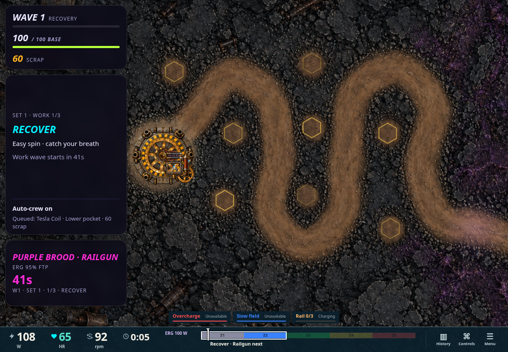

The instrument bar and floating actions are measured separately. Renderers receive
both their occupied rectangles and a conservative combined bottom inset. Optional
history and help reserve no viewport height. The desktop instrument bar is 59px;
controller indicators add about 28px only where needed. Phone wraps naturally.

## Full controls at start and pause

The guide includes every current binding, grouped directions/paddles and face
actions, physical button maps, custom shifters and gears. Face order is stable
A/B/Y/Z, with explicit spatial exceptions such as Cadenza Z Left / A Right.
Games with loadout menus show gameplay controls after selection. Starting is
explicit; instructions no longer disappear on an eight-second timer. D-pad arrows
scroll long guides. The action footer stays visible on phones.

During play, Controls pauses into the same guide; Escape/B returns to Pause.
Fake-bike instructions stay in Pause/help. Recent history is available on demand
and through Pause -> History. Existing game-specific pause actions and Finish ride
remain available independently.

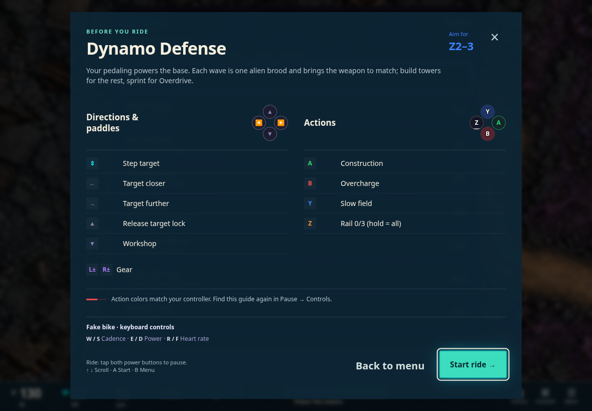

## All eight games

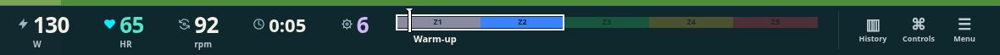
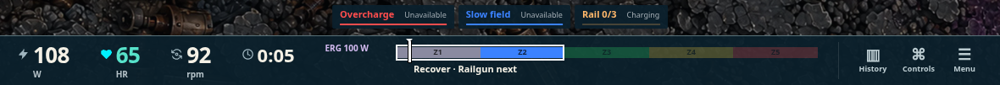
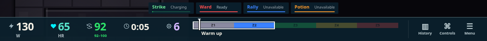
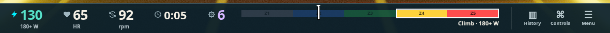
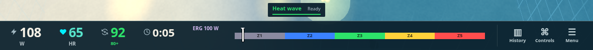
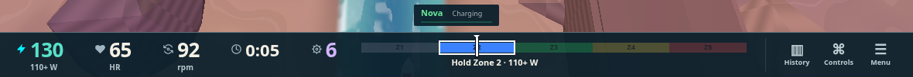
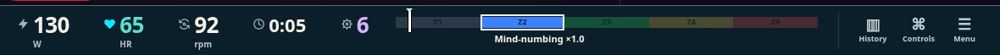
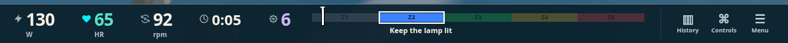

Cooldown data covers Tower Defense, Crank Crawler, Nova charge and Watershed's
phase boost. Rail preserves its charge count; boss sprint windows and trial offers
appear contextually. Charge is distinct from usability. Squadron's duplicate
canvas Nova/target buttons are hidden when the shared HUD owns the controls;
standalone renderers retain their fallback.

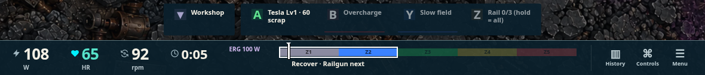

[Phone start/pause guide](guide-phone.png) · [Long-price phone capture](long-price-phone.png) · [Short-landscape Cadenza](cadenza-short.png)

## Validation and reproduction

- Typecheck and production build.
- 193 shell/debug tests and 167 affected game tests, including all-game indicator
  metadata, connection presence, manual override, held-input cancellation,
  complete/stable legends, post-loadout start gating and measured insets.
- 48 native Chromium layout checks: eight games x tablet/short-landscape/phone x
  controller/touch. Zero page errors, off-screen controls, clipped labels or
  undersized touch targets. Auto connect/disconnect, optional history and fake-help
  placement also pass; [capture checks](checks.json).
- Tower Defense browser smoke covers both modes at four sizes, mixed workshop
  input, quoted affordability, Rail tap/hold, touch drag/layout cancellation,
  keyboard/touch boss boost and construction cancellation.
- `check-hud-flow.mjs` exercises the actual GameHost: post-loadout guide, explicit
  start, keyboard/controller input, pause/help return, connection fallback,
  persistent touch override and phone guide scrolling/actions.

Run Vite on port 5212, then:

```
REVIEW_URL=http://127.0.0.1:5212 node scripts/check-compact-hud.mjs
REVIEW_URL=http://127.0.0.1:5212 node scripts/check-hud-flow.mjs
TOWERDEFENSE_BASE=http://127.0.0.1:5212 node scripts/towerdefense-hud-smoke.mjs
```

`HUD_GAMES` / `HUD_SIZES` can focus the layout matrix. Review pages:
`/dev/hud-live.html?game=cadenza` (controller), `legend=0` (touch), `layout=auto`,
`menu=1` (game menus), `manual=1` (freeze), and `/dev/hud-flow.html?game=dungeon`
(actual startup/pause flow).

Native iPad/Bluefy frame pacing and a physical Ride-controller pass remain device
validation. This change does not implement the separate achievements/chrome study.
