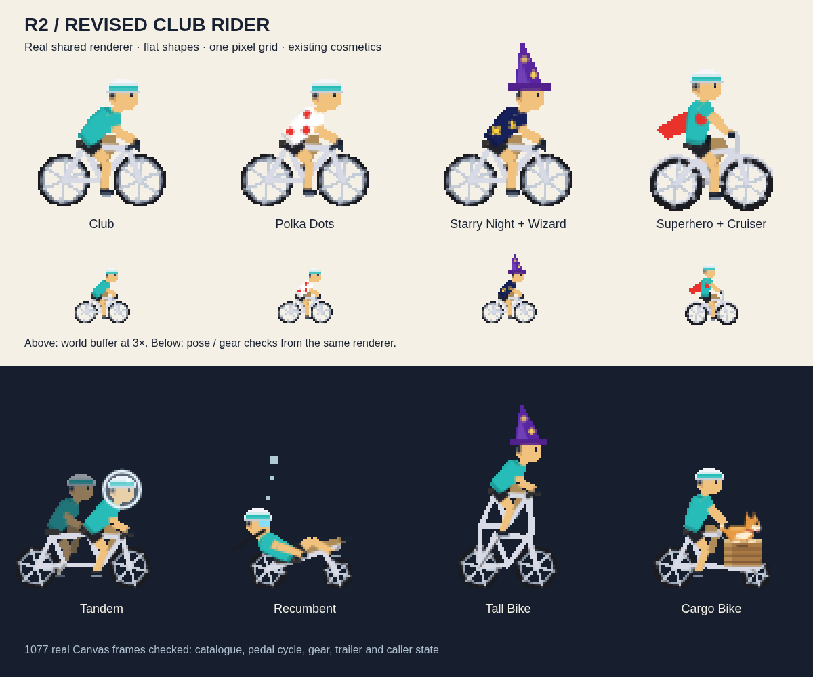
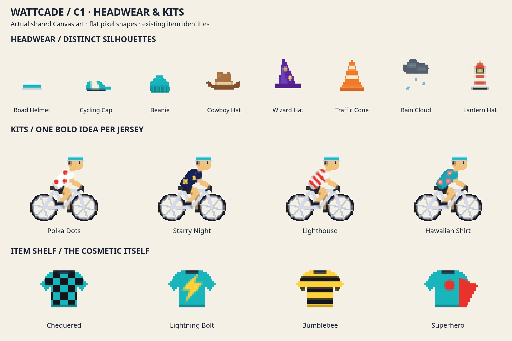
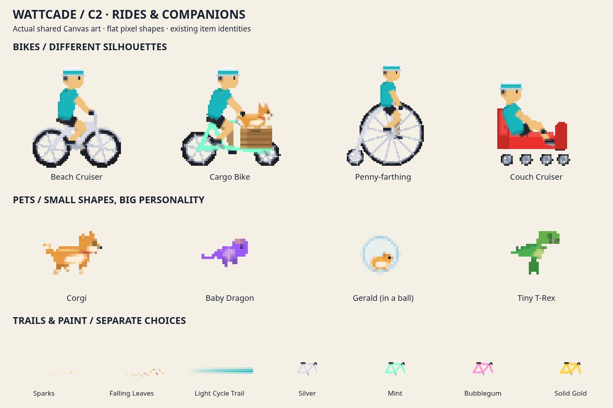
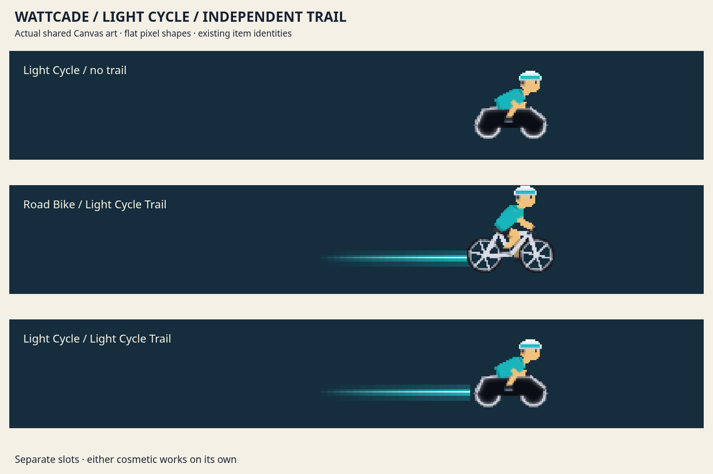

# Flat pixel rider and cosmetics

The shared renderer uses short polygon jersey shapes, a distinct cartoon head, bent limbs and a fixed two-pixel grid per rider unit. Solid art has binary alpha; glass and translucent gear composite separately. This renderer is shared by the overworld, avatars and vehicle cab. Cadence and wheel distance extrapolate by at most one simulation tick; raw zero cadence stops the feet while coasting wheels continue.

The Light Cycle bike keeps its existing Arcade Rat unlock. Its light wall is a separate trail, usable on any bike, unlocked by Afterglow: ten arcade rides with at least 600 active-cadence samples each. The counter starts with future qualifying rides; it does not infer past ride durations. Existing cosmetic IDs remain stable.

Isolated item art and avatar bounds provide the artwork foundation for the separate reward/selection UI PR. Reward screen behavior is outside this branch.

## Reproduce
Start `npm run dev -- --host 127.0.0.1 --port 5199 --strictPort`. With Chromium at `/usr/bin/chromium` and ffmpeg installed:

- `node scripts/check-rider-style.mjs` checks real Canvas output across all bikes, gear, pedal phases, tall hats, trailer and trails, including caller state and opaque silhouette edges.
- `node scripts/capture-rider-motion.mjs` produces an eight-second 60 fps clip and GIF with pedaling, deceleration and coasting.

Outputs default to `/tmp/wattcade-player`; pass an output directory as the first argument. Test cosmetics, progression, RiderAvatar and warmup; run typecheck and build. Native iPad/WebKit frame pacing remains a device check.
