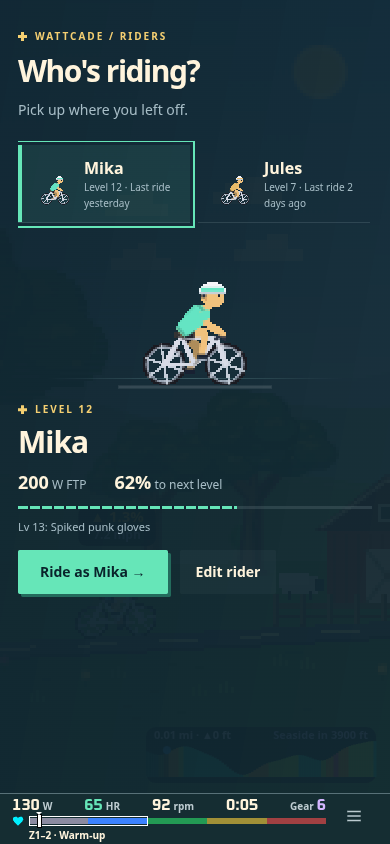
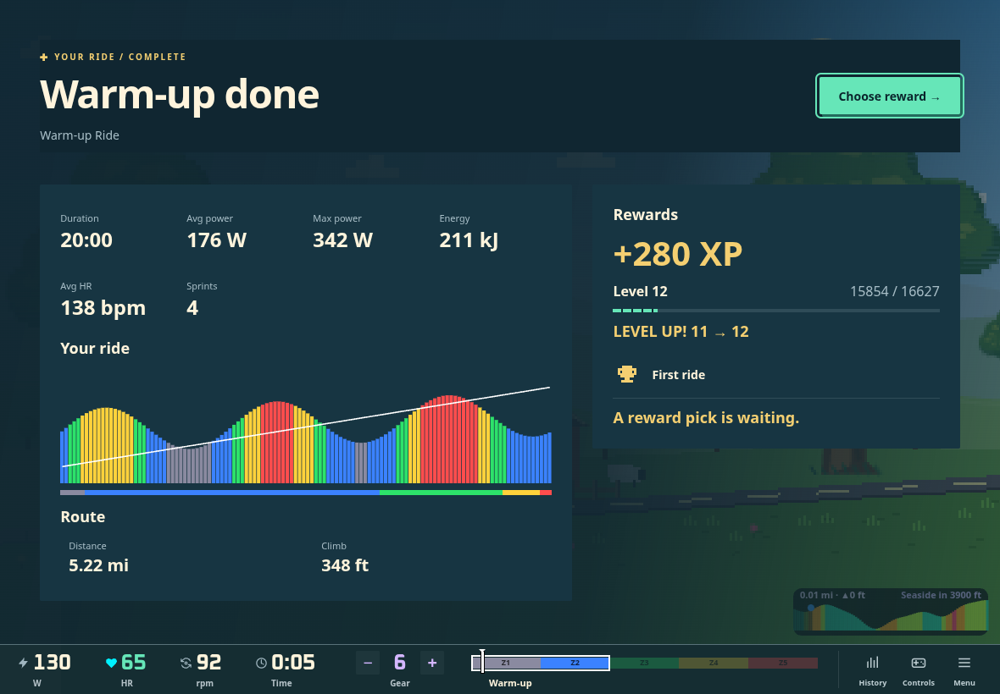

# Pocket Arcade — production default

Pocket Arcade now lives in the shared UI tokens, DOM widgets, Canvas adapter and
shell chrome. These captures use the default styles, with no variant parameter.

- Warm navy surfaces, cream text, mint actions/focus and gold milestones.
- Heavier display headings, pixel-star eyebrows and a stronger selected-row edge.
- Primary buttons have a solid 3px key edge that depresses on press. DOM reduced
  motion keeps the button position fixed; focus remains explicit and separate.
- Progress uses 10px segments with 2px ticks in both DOM and Canvas. Effort-zone
  bars/charts retain their semantic colors and continuous band layout.
- The HUD uses the warm palette while retaining its numeric typography, balanced
  gear stepper, compact dimensions and controller/touch behavior.

Source: `src/ui/tokens.ts`, `widgets.css`, `canvas.ts` and
`src/shell/chrome/chrome.css`. The canonical [style guide](../../UI_STYLE_GUIDE.md)
explains adoption. No runtime dependencies or new persistent settings were added.

Sunset Sprint and Coin-Op remain development-only explorations. They are not
complete production themes: Canvas equivalents and theme persistence are absent.
Accordingly, they are not exposed in Settings. They remain reviewable through
`variant=sprint` / `variant=coinop`; `variant=pocket` matches the default.





## Captures

| Surface | Capture |
| --- | --- |
| Rider selector | [Phone](phone-riders.png), [desktop](desktop-riders.png) |
| Ride summary | [Desktop](desktop-summary.png) |
| Pause | [Phone](phone-pause.png) |
| Arcade selector | [Desktop](desktop-arcade.png) |
| Music | [Phone](phone-media.png) |
| Connection | [Small phone](phone-connect.png) |
| Achievement notification | [Phone](phone-achievement.png) |
| Shared DOM and Canvas widgets | [Desktop gallery](desktop-ui-kit.png) |

Reproduce using Vite, with HMR disabled when writing capture files into the repo:
`/dev/chrome-review.html?game=warmup&manual=1&fake=0&legend=0&proof=1&view=riders`.
Use `summary`, `pause`, `arcade`, `media`, `connect`, or `achievement` for the other
screens. Open `/dev/ui-kit.html` for the DOM/Canvas gallery.

The chrome captures use production components over the actual Warm-up renderer
with synthetic review profiles/session data and no connected hardware. Viewports
are 390×844 or 1180×820; connection uses 320×568. The gallery is a full-page 1180px
capture. Native iPad/Bluefy and physical controller validation remains a device check.

Validation: typecheck and production build; 224 UI/shell tests; all 56 chrome
screen/viewport checks at 320×568, 390×844, 844×390 and 1180×820; a repeat of the four
rider sizes after the final heading fix; standalone gallery checks at 320px and
1180px for keyboard actions, tabs, tooltips, reduced motion and 44px controls.
Canvas progress also checks that partial ticks stay inside the filled portion.

```sh
npm run typecheck
npx vitest run src/ui src/shell
npm run build
CHROME_REVIEW_URL=http://127.0.0.1:5223 node scripts/check-chrome.mjs
CHROME_REVIEW_URL=http://127.0.0.1:5223 node scripts/check-ui-kit.mjs
```
