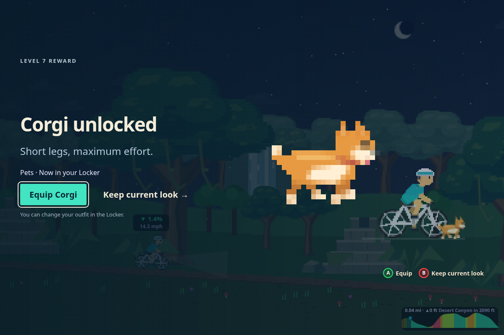
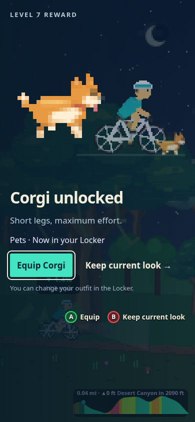
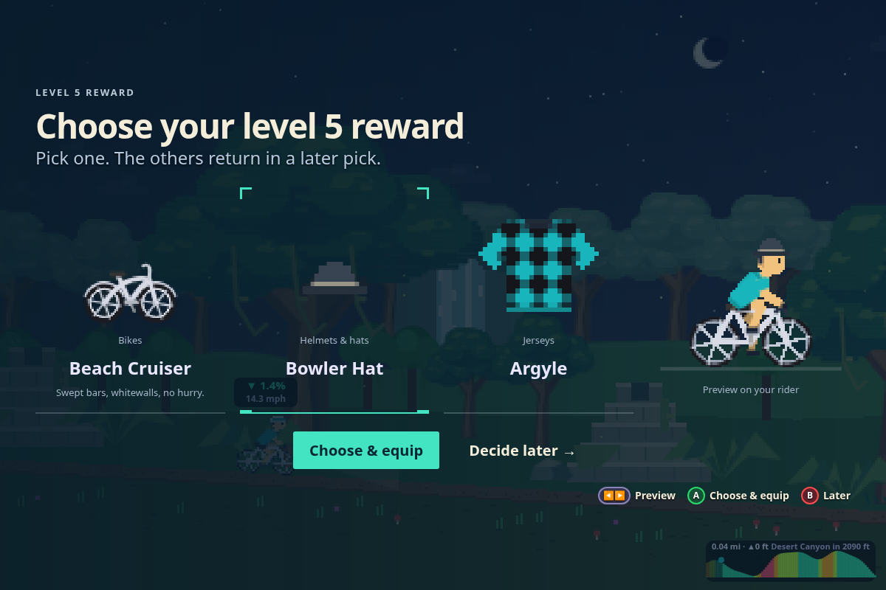
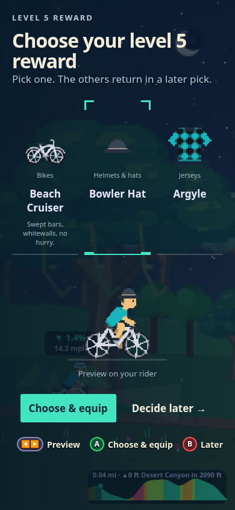
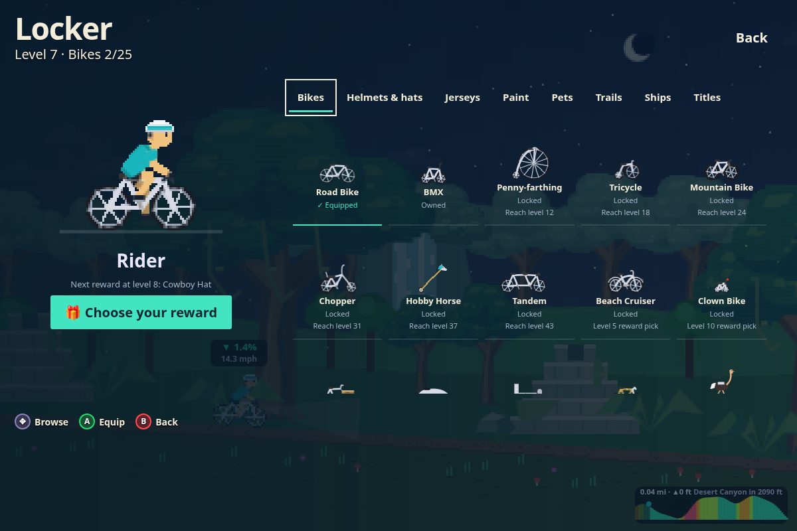
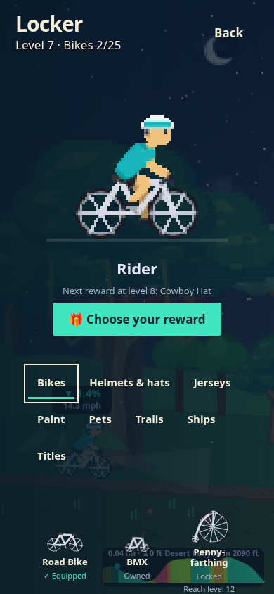

# Cosmetic rewards and selection

Depends on the separate player/cosmetics branch for isolated item artwork and avatar bounds. Broader Arcade, pause and live HUD redesigns remain future work.

After Summary, show already-earned fixed rewards with an optional Equip action. Keep current look preserves the outfit. Continue through multiple fixed rewards, then to pending reward choices or Arcade. Choosing an item previews it; Choose & equip claims it deliberately. Defer preserves the choice for later. Duplicate saves are guarded; failed saves can be retried. Locked locker items remain named, show full artwork and state their unlock requirement.

| Screen | Desktop | Phone |
| --- | --- | --- |
| Unlock |  |  |
| Selection |  |  |
| Locker |  |  |

## Reproduce
Start `npm run dev -- --host 127.0.0.1 --port 5199 --strictPort`, then `node scripts/capture-cosmetic-review.mjs --stills` with Chromium at `/usr/bin/chromium`. Omit `--stills` to also capture the independent trail clip (requires ffmpeg). Output defaults to `/tmp/wattcade-rewards`; supply a directory argument to override it. `REVIEW_URL` can target another local server.

Run `npm test -- src/shell/screens/CosmeticRewards.test.tsx src/shell/components/RiderAvatar.test.tsx src/shell/App.test.tsx`, typecheck and build. Browser captures check both 1200×800 and 390×844 layouts for overflow and JavaScript errors. A physical controller and native iPad/WebKit pass remain next steps.
