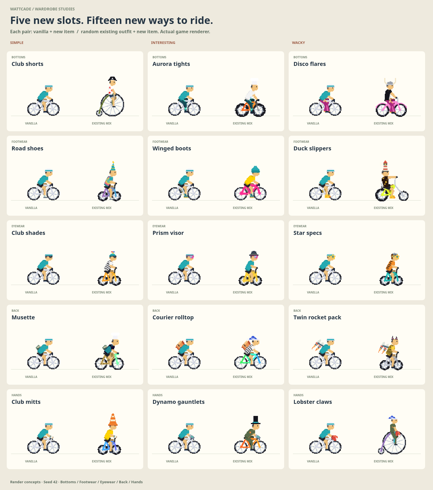

# Wardrobe studies

The [implemented collection and browser proof](implemented/README.md) now cover the complete rotation, including the tutu. The original study below contains fifteen render-only concepts across five independently composited groups. Each has a simple, interesting, and wacky option. These use the shared rider renderer, pixel grid, bike geometry, and live pedal joints. The original images remain as an art-study record; the implemented collection uses the revised reward sources and preserves earned originals in Legacy.

The [rotation and unlock proposal](UNLOCK-PROPOSAL.md) lists proposed retirements, slot moves, all achievement reward sources, and the complete level track.

| Group | Simple | Interesting | Wacky |
| --- | --- | --- | --- |
| Bottoms | Club shorts | Aurora tights | Disco flares |
| Footwear | Road shoes | Winged boots | Duck slippers |
| Eyewear | Club shades | Prism visor | Star specs |
| Back | Musette | Courier rolltop | Twin rocket pack |
| Hands | Club mitts | Dynamo gauntlets | Lobster claws |



## Review

Start `npm run dev -- --host 0.0.0.0 --port 5199 --strictPort` and open `/dev/wardrobe-review.html?seed=42`. The page supports pedaling, repeatable random outfit shuffles, day/night backgrounds, group navigation, and small rider views. `/dev/wardrobe-review.html?seed=42&overview=1` shows the contact sheet.

Each detailed card pairs the starter outfit with a seeded random selection of existing bikes, hats, jerseys, paints, and occasional pets and trails. Full-face headwear is excluded from these random mixes so eyewear can be judged; occlusion is checked separately. The final row combines all five new slots, once with vanilla and once with an existing outfit.

- [Bottoms](bottoms.png), [footwear](footwear.png), [eyewear](eyewear.png), [back](back.png), [hands](gloves.png)
- [All five slots together](combined.png) and [night backdrop](combined-night.png)
- [Pedaling clip](outfits-motion.mp4), [animated preview](outfits-motion.gif), and [phone card](phone-card.png)
- [Canvas checks](render-checks.json)

## Behavior

New bottoms override the jersey's legacy leg colors; without a bottoms concept the jersey keeps its original legs. A new back item replaces a jersey's built-in cape. Boots and slippers follow each foot independently. Gloves follow the elbow-to-hand frame. Eyewear is hidden by full-head hats and the welding mask, and appears under translucent biome gear. Rocket flames stop when road speed reaches zero.

## Reproduce and validate

With Vite on port 5199, Chromium at `/usr/bin/chromium`, and ffmpeg installed, run:

```sh
node scripts/capture-wardrobe-review.mjs docs/visual-polish/wardrobe
npm run typecheck
npx vitest run src/cosmetics src/shell/components/RiderAvatar.test.tsx
node scripts/check-rider-style.mjs /tmp/wattcade-wardrobe-regression
npm run build
```

The capture script checks that every concept changes visible pixels, exercises the complete wacky outfit on every bike at four crank phases, checks helmet occlusion, biome gear, and stopped rocket flames, and verifies shuffle/animation controls and phone overflow. It captures six detailed boards, a contact sheet, night and phone views, and a three-second motion clip. Pass `--stills` after the output directory to skip video encoding. Use `REVIEW_URL` for a different dev server.
