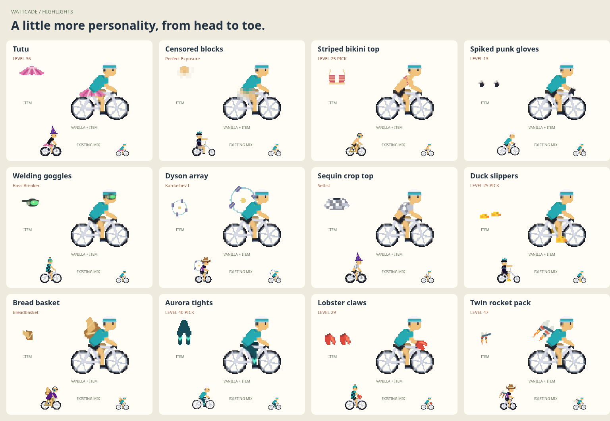

# Implemented wardrobe

Five new equipment slots — Bottoms, Hands, Feet, Eyewear, and Back — are available in the Locker. Jerseys is now Tops, with actual cropped, sleeveless, bikini, hoodie, jacket, coat, mesh, and knotted garment cuts. Tutu is the guaranteed level-36 reward. Every game awards exactly one signature title; levels award none.



The active catalog has 219 items including starter/empty options, covering all 137 achievements and 69 level/pick reward entries. There are 94 new wearable designs (83 independent accessories/garments and 11 tops with new garment cuts). The 97 replaced original forms are removed from player inventories: 83 retirements, 11 slot moves, and three re-cuts. The complete source map is in [the rotation proposal](../UNLOCK-PROPOSAL.md).

All profiles derive ownership from the current catalog, level, achievements and chosen rewards. Old chosen picks map to current replacements, including picks beyond level 50; retired or newly ineligible equipment falls back to starters. There is no Legacy collection or ownership exception. Earlier ownership snapshots are discarded on read/import, and backups contain current choices only. Achievements, XP, level thresholds and game saves stay unchanged.

Locker browsing groups are Ride, Rider, Company & effects, and Identity. Ships have moved to Cadenza’s pre-ride menu with a hull preview and locked-ship hints. Encore still unlocks Lancer and Launch Pad still unlocks Manta; both achievements also award their shared wardrobe pieces. Existing equipped ship selections remain valid until changed locally.

## Review artifacts

- [Bottoms](bottoms.png), [tops](jersey.png), [hands](hands.png), [feet](feet.png), [eyewear](eyewear.png), [back](back.png)
- [Desktop Locker](locker-desktop.png), [phone Locker](locker-phone.png)
- [Cadenza ship selection](cadenza-ships.png), [locked ships](cadenza-locked.png)
- [Scene-based censor effect](censor-scene-proof.png), [checks](censor-checks.json): actual pixelation of a featureless pantless rider, bike and background, with subtle noise.
- [Canvas validation](render-checks.json): each new wearable changes visible rider pixels and has isolated shelf art; 300 combined outfit poses across all 25 bikes; retired items stay unavailable even to old profiles.

## Reproduce

Start Vite on localhost, then open `/dev/wardrobe-catalog.html`. It shows actual catalog items, source labels, isolated icons, starter/mixed/small views, and pedaling. `/dev/cosmetic-review.html?mode=wardrobe-locker` is a disposable full-progress profile for reviewing the real Locker.

```sh
npm run dev -- --host 127.0.0.1 --port 5199 --strictPort
node scripts/check-wardrobe.mjs
node scripts/check-censor.mjs
node scripts/check-rider-style.mjs /tmp/wattcade-player
npm run typecheck
npm test
npm run build
```

Pass an output directory to either capture script; set `REVIEW_URL` to use a different local server. `check-wardrobe.mjs <output> --ui-only` skips the gallery captures but still validates worn/shelf art and the real menu controls. The original fifteen-concept review is retained at `/dev/wardrobe-review.html`.

## Verification results

Typecheck and production build passed. The current regression run passed 312 tests across 52 files in cosmetics, progression, the shell and Cadenza. Browser checks verify 94 worn/shelf designs, 300 combined poses, desktop/phone Locker interactions, retired-item exclusion even for old profiles, and locked/unlocked ship selection above the HUD. Native iPad/Bluefy remains a device check.

The censor follow-up samples the completed Canvas scene rather than painting a garment. Additional browser checks cover three source backgrounds, rotated/reflected camera transforms, clipping, transparent previews, caller alpha/state, and all 25 bikes at four crank phases. The featureless bare body remains underneath the coarse mosaic; no scene pixel readback is required.
